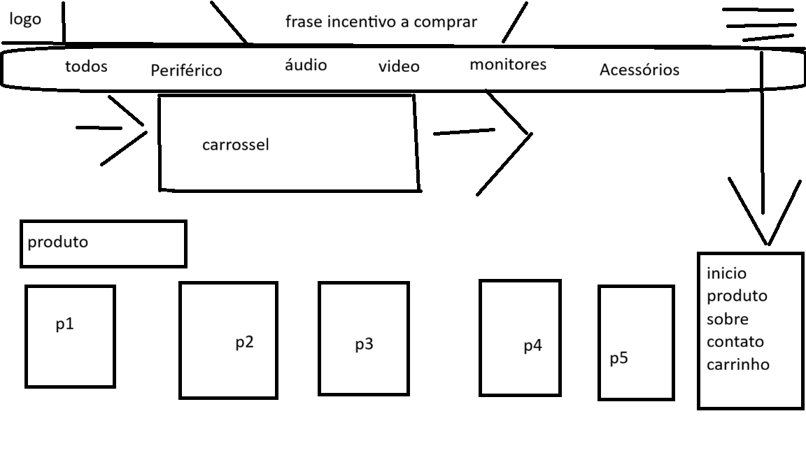

# 🛒 TechStore 2026

Meu primeiro projeto de e-commerce, desenvolvido com **HTML, CSS e JavaScript**. A TechStore é uma loja fictícia de tecnologia com produtos de áudio, vídeo, monitores e periféricos.

## 📸 Preview



## 🚀 Funcionalidades

- Página inicial com destaque de produtos
- Páginas de categorias: áudio, vídeo, monitores e periféricos
- Página de detalhes do produto
- Carrinho de compras
- Página "Sobre" e página de contato
- [adicione outras funcionalidades que você fez]

## 🛠️ Tecnologias utilizadas

- HTML5
- CSS3
- JavaScript

## 📁 Estrutura do projeto

```
techstore_estudado/
├── docs/
│   └── wireframes/     # protótipos das telas
├── index.html          # página inicial
├── produto.html        # página de produto
├── sobre.html          # página sobre
└── README.md
```

## ▶️ Como executar

1. Clone o repositório:
```bash
   git clone https://github.com/joaovls2004/e-comeerce-techstore2026.git
```
2. Entre na pasta do projeto:
```bash
   cd e-comeerce-techstore2026
```
3. Abra o arquivo `index.html` no navegador (ou use a extensão **Live Server** do VS Code).

## 🎨 Wireframes

Os protótipos das telas ficam na pasta [`docs/wireframes`](docs/wireframes).

## 📚 Aprendizados

Este projeto me ajudou a praticar:

- Estruturação de páginas com HTML semântico
- Estilização e layout com CSS
- Interatividade com JavaScript
- Versionamento com Git e GitHub

## 👨‍💻 Autor

**João Vinícius**
GitHub: [@joaovls2004](https://github.com/joaovls2004)
